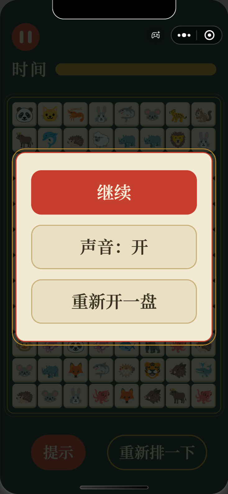
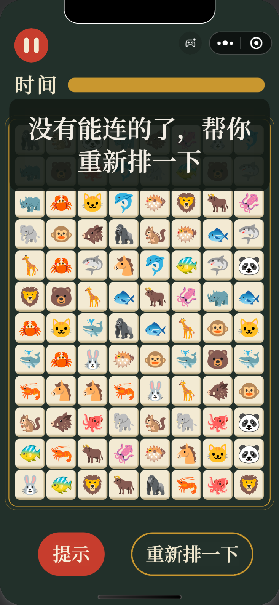
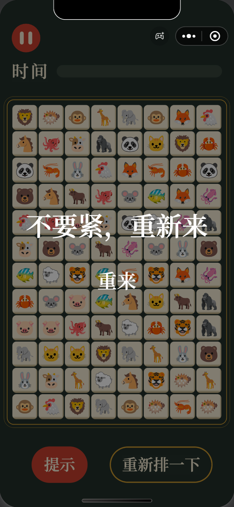

<a href="https://github.com/MoonMere/lianliankan-wechat-game/blob/main/README.zh-CN.md"><kbd>中文</kbd></a>

# 外婆爱游戏 (Granny Loves Games)

A lianliankan (连连看) tile matching game, released as a WeChat Mini Game. It is a personal project that I built between July and August 2026 by directing an AI coding tool, Claude Code.

I first made it for my grandmother, which is where the name comes from. By August 2026, it was live on WeChat for anyone to play.

<table>
  <tr>
    <td></td>
    <td></td>
    <td></td>
    <td></td>
  </tr>
  <tr>
    <td align="center">A board in play</td>
    <td align="center">Pause menu</td>
    <td align="center">No moves left, so the game reshuffles</td>
    <td align="center">Time is up</td>
  </tr>
</table>

## How to play

- Tap two matching animals to clear them. The line joining them can turn at most twice.
- Clear the board before the time bar runs out. The time limit for each new board adapts to how fast you play.
- 提示 (Hint) and 重新排一下 (Reshuffle) are free and unlimited, and the game reshuffles for you when no moves are left.

The game has no ads and nothing to buy. All text in the game is in Chinese.

## How I made it with AI

Claude Code wrote all of the code. The game uses TypeScript and the Cocos Creator 3.8 game engine. My part was deciding what the game should be, making the calls along the way, testing it and releasing it.

- A series of AI conversations wrote a detailed plan and broke the work into steps. Other conversations wrote most of the code from those steps. Each conversation ended with a handoff note, so the next one could carry on where it stopped.
- I made the big decisions myself and left technical details and some design choices to the AI. For the look, the AI mocked up three visual styles and I picked one.
- The AI wrote automated tests for the game logic and compared visual changes with the design mockup. I tested builds on my own phone and handled the WeChat registration and review myself.

## On WeChat

On WeChat, the game is called **外婆爱游戏**.

## About this repository

This repository only holds this description and some screenshots. The four game screenshots come from the WeChat developer tools simulator in July 2026. The loading screen was captured on a phone.

## Credits

- Animal icons: [Noto Color Emoji](https://github.com/googlefonts/noto-emoji) by Google, Apache License 2.0
- Font: Noto Serif SC, SIL Open Font License
- Sound effects: [Kenney](https://kenney.nl), CC0
